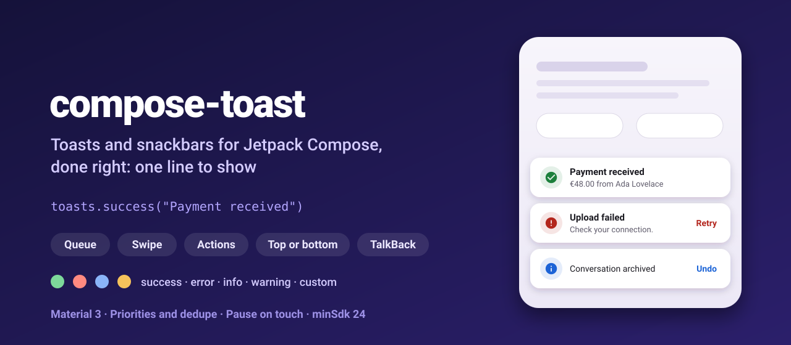
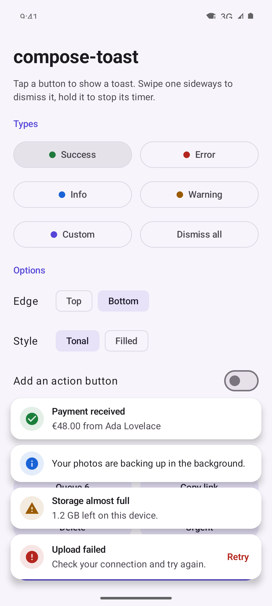
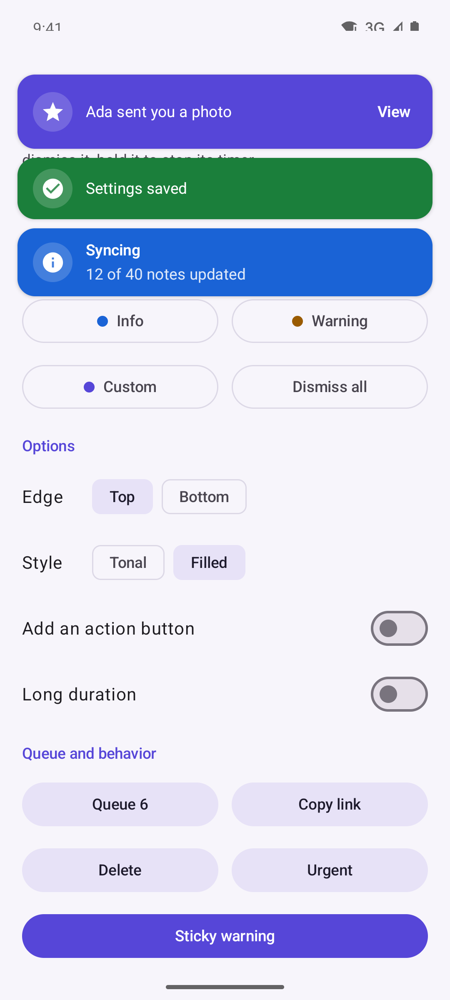
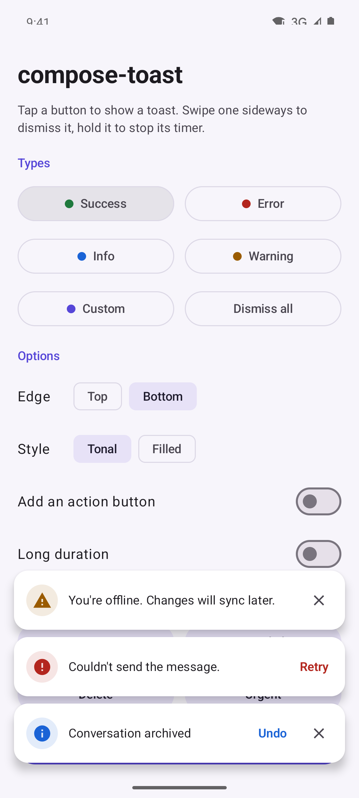
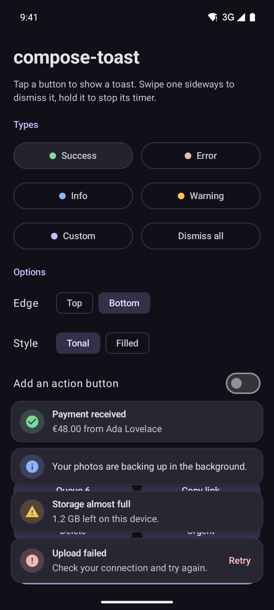
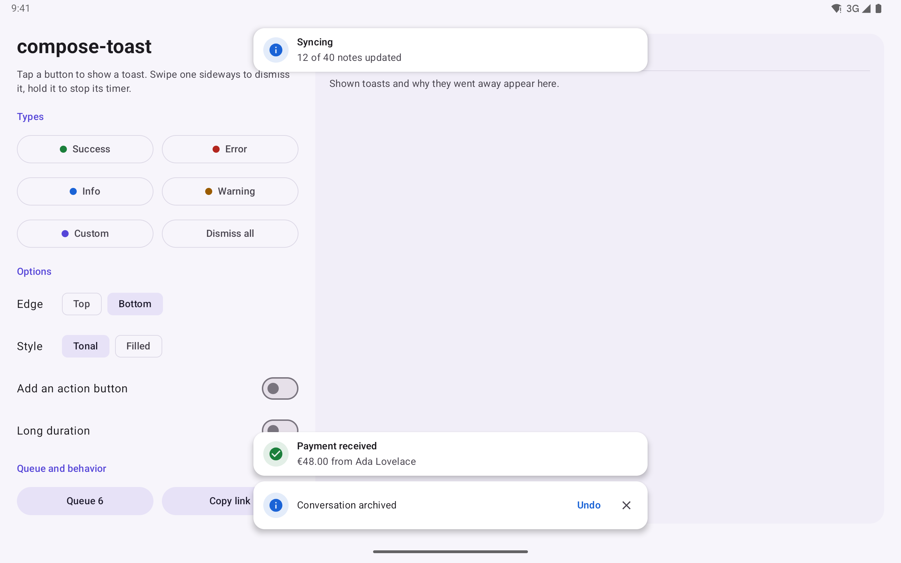

<p align="center">
  
</p>

<p align="center">
  <a href="https://github.com/halilozel1903/compose-toast/actions/workflows/ci.yml"></a>
  <a href="https://jitpack.io/#halilozel1903/compose-toast"></a>
  
  
  
  <a href="LICENSE"></a>
</p>

**compose-toast** is toasts and snackbars for Jetpack Compose done right. Show one with a single line: success, error, info, warning or your own style, at the top or bottom of the screen, with an action button like Undo or Retry. Several toasts stack; more wait in a queue ordered by priority, and duplicates are merged. Swipe a toast sideways to dismiss it, hold it to stop its timer, and TalkBack users hear it and get more time. Timers, queue and dedupe live in a pure Kotlin module with unit tests.

```kotlin
val toasts = rememberToastState()

Box(Modifier.fillMaxSize()) {
    MyScreen(onSave = { toasts.success("Payment received") })
    ToastHost(toasts)
}
```

## Screenshots

Captured from the sample app on an Android emulator by CI.

| Styles | At the top, filled | Actions | Dark mode |
| :---: | :---: | :---: | :---: |
|  |  |  |  |

**Tablet:** toasts stay centered and at most 560 dp wide over a two pane layout.



## Features

- **One line to show**: `toasts.success("Saved")`, `toasts.error(...)`, `toasts.info(...)`, `toasts.warning(...)` or `toasts.show(...)` with every option. No coroutine needed.
- **Five types**: success, error, info, warning and custom, each with its own icon and color. Pass any `ImageVector` as the icon.
- **Two styles**: `Tonal` (theme surface with a colored icon badge) and `Filled` (colored background). Colors come from your Material 3 theme and have light and dark variants.
- **Top or bottom**: per toast or as the default of the state. The newest toast sits closest to its edge.
- **Stacking and a queue**: up to `maxVisible` toasts per edge (3 by default); the rest wait, highest priority first, then oldest first. `ToastPriority.Urgent` takes a place at once.
- **Deduplication**: toasts with the same `dedupeKey` show once. Restart the timer (default), ignore the new one, or replace the text in place.
- **Actions**: an action button (`actionLabel` and `onAction`), an optional close button, and `showAndWait` that suspends until the toast is gone and tells you whether the action was used.
- **Swipe to dismiss** in either direction, with a fling, fading as it goes.
- **Pause on touch**: holding a toast stops its timer; letting go gives it at least 1.5 seconds more. Timers also stop while the host is not on screen.
- **Durations**: Short (4 s), Long (7 s), Indefinite or `Custom(millis)`. Long texts get reading time, toasts with an action stay at least 8 s.
- **Accessibility**: toasts are live regions (errors are assertive) that announce their type, title, message and action; TalkBack gets "Dismiss" and the action as actions. With TalkBack on, toasts last twice as long and toasts with an action wait for the user. Android's "Time to take action" setting is respected.
- **Enter and exit animations**: slide, fade and scale in from the edge; the stack closes smoothly when a toast leaves.
- **Phone and tablet**: window insets (status bar, navigation bar, keyboard) are respected, and toasts are centered with a maximum width.
- **Pure Kotlin core** (`compose-toast-core`): the model, queue, scheduler with a clock you control, timeout rules and swipe decisions, unit tested.

## Installation

Add JitPack to `settings.gradle.kts`:

```kotlin
dependencyResolutionManagement {
    repositories {
        google()
        mavenCentral()
        maven("https://jitpack.io")
    }
}
```

Then the dependency:

```kotlin
dependencies {
    implementation("com.github.halilozel1903.compose-toast:compose-toast:1.0.0")
    // Pure Kotlin queue and timing only (for JVM/KMP modules or your own UI):
    // implementation("com.github.halilozel1903.compose-toast:compose-toast-core:1.0.0")
}
```

> The build is also set up for Maven Central (`io.github.halilozel1903:compose-toast`) via the vanniktech publish plugin.

## Quick start

**Add a host once**, above your content, usually at the root of the screen or the app:

```kotlin
@Composable
fun App() {
    val toasts = rememberToastState()
    Box(Modifier.fillMaxSize()) {
        AppNavigation(toasts)
        ToastHost(toasts)          // last, so it is drawn on top
    }
}
```

With a `Scaffold`, put the `ToastHost` in a `Box` around it, or pass the state down with a `CompositionLocal` of your own.

**Show toasts**

```kotlin
toasts.success("Payment received")
toasts.info("Syncing 12 notes", position = ToastPosition.Top)
toasts.warning("1.2 GB left on this device", title = "Storage almost full")
toasts.error(
    "Check your connection and try again.",
    title = "Upload failed",
    actionLabel = "Retry",
    onAction = { viewModel.retryUpload() },
)
```

**Everything `show` can do**

```kotlin
val id = toasts.show(
    message = "Ada sent you a photo",
    type = ToastType.Custom,
    title = null,
    actionLabel = "View",
    onAction = { openPhoto() },
    duration = ToastDuration.Long,          // Short, Long, Indefinite or ToastDuration.Custom(2_500)
    position = ToastPosition.Top,           // default: the state's defaultPosition (Bottom)
    priority = ToastPriority.High,          // Low, Normal, High, Urgent
    dedupeKey = "photo-from-ada",           // shown once while visible or waiting
    showCloseButton = true,
    swipeToDismiss = true,
    icon = Icons.Rounded.Photo,             // any ImageVector
    onDismiss = { reason -> log(reason) },  // Timeout, Swiped, ActionClicked, Closed, Programmatic, Preempted, Dropped
)
toasts.dismiss(id)
toasts.dismissAll()
```

**Wait for the result**, like `showSnackbar`:

```kotlin
scope.launch {
    val result = toasts.showAndWait("Message deleted", actionLabel = "Undo", showCloseButton = true)
    if (result == ToastResult.ActionPerformed) viewModel.restore(message)
}
```

**From a ViewModel**: keep the ViewModel free of UI types and send events that the screen turns into toasts:

```kotlin
LaunchedEffect(Unit) {
    viewModel.events.collect { event ->
        when (event) {
            is Saved -> toasts.success("Saved")
            is Failed -> toasts.error(event.message, actionLabel = "Retry", onAction = viewModel::retry)
        }
    }
}
```

## Configuration

```kotlin
val toasts = rememberToastState(
    config = ToastQueueConfig(
        maxVisible = 3,                                   // per edge
        maxQueued = 32,                                   // the least important waiting toast is dropped beyond this
        duplicatePolicy = DuplicatePolicy.RestartTimer,   // or Ignore, Replace
        timeouts = ToastTimeoutPolicy(shortMillis = 3_000, longMillis = 6_000),
        minRemainingAfterResumeMillis = 1_500,
    ),
    defaultPosition = ToastPosition.Top,
)

ToastHost(
    state = toasts,
    style = ToastStyle.Filled,
    maxWidth = 480.dp,
    windowInsets = WindowInsets.safeDrawing,
    labels = ToastLabels(dismiss = "Kapat"),              // TalkBack words, localizable
)
```

| `ToastHost` parameter | Default | Meaning |
| --- | --- | --- |
| `style` | `ToastStyle.Tonal` | `Tonal` or `Filled` |
| `maxWidth` | 560 dp | Toasts are centered and never wider |
| `windowInsets` | `safeDrawing` | Keeps toasts clear of system bars, cutouts and the keyboard |
| `contentPadding` | 16 dp / 12 dp | Space to the screen edges |
| `spacing` | 8 dp | Space between stacked toasts |
| `labels` | English | Type names, action hint and "Dismiss" for TalkBack |
| `toast` | `ToastCard` | Draws one toast; the host adds animation, swipe, pause and accessibility |

**Your own toast design**: the host keeps the behavior, you draw the card:

```kotlin
ToastHost(toasts) { data ->
    Surface(shape = CircleShape, color = MaterialTheme.colorScheme.inverseSurface) {
        Row(Modifier.padding(horizontal = 20.dp, vertical = 12.dp), verticalAlignment = Alignment.CenterVertically) {
            Text(data.message, Modifier.weight(1f, fill = false))
            data.actionLabel?.let { TextButton(onClick = data::performAction) { Text(it) } }
        }
    }
}
```

`ToastCard(message, type = ..., title = ..., actionLabel = ...)` is the default design as a plain composable, handy in previews, and `ToastDefaults.colors(type, style)` gives its colors.

## How timing works

```text
Short 4 s / Long 7 s
  + reading time: 40 ms per character beyond 60, at most 5 s
  at least 8 s when there is an action
TalkBack on: x2, and toasts with an action wait for the user
"Time to take action" setting: can only make it longer
Custom(millis): used as is (only the system setting can lengthen it)
Indefinite: until swiped, closed, its action is used or it is dismissed in code
Touch or host off screen: the timer stops and keeps what is left; after a touch at least 1.5 s remain
```

The queue in `compose-toast-core` has no coroutines or threads. Every call works on the time of a `ToastClock`, so it is deterministic and easy to test:

```kotlin
val clock = object : ToastClock { var now = 0L; override fun nowMillis() = now }
val queue = ToastQueue(ToastQueueConfig(maxVisible = 1), clock)

val first = queue.enqueue(ToastRequest("Saved", duration = ToastDuration.Custom(3_000)))
val second = queue.enqueue(ToastRequest("Synced"))       // waits
clock.now = 3_000
queue.tick()                                             // first times out, second appears
queue.visible.single().id == second                      // true
queue.nextDeadlineMillis()                               // 7_000
```

## Sample app

The `sample` module is a playground: a button for each type, Top or Bottom, Tonal or Filled, an action switch, a queue of six, a copy button that is deduplicated, a Delete with Undo through `showAndWait`, an urgent toast and a sticky warning. An activity log shows each toast and why it went away. On screens 720 dp and wider it switches to a two pane layout.

Taps can't be timed reliably through adb, so the sample shows screenshot scenes from an intent extra, with toasts that never time out (used by `scripts/screenshots.sh`):

```bash
./gradlew :sample:installDebug
adb shell am start -n io.github.halilozel1903.toast.sample/.MainActivity --es scene styles
```

`scene` is one of `styles` (four types stacked at the bottom), `top` (filled toasts at the top), `action` (Undo, Retry and close buttons) or `tablet` (both edges, for the tablet shot). CI checks every capture for the scene's text and fails on blank images.

## Project structure

| Module | What it is |
| --- | --- |
| `toast-core` | Pure Kotlin: `Toast`, `ToastRequest`, `ToastQueue` (stacking, priority, dedupe, pause, timers on a `ToastClock`), `ToastTimeouts`, `ToastSwipe`, `ToastAnnouncement`. Published as `compose-toast-core` |
| `toast` | Compose: `ToastHost`, `ToastState`, `rememberToastState`, `ToastCard`, `ToastDefaults`, `ToastIcons`. Published as `compose-toast` |
| `sample` | A playground for phone and tablet, with screenshot scenes |

## Tech stack

Kotlin 2.4 · AGP 9.4 with built-in Kotlin · Gradle 9.6 · Jetpack Compose (BOM 2026.09) · Material 3 · Compose animation (`AnimatedVisibility`, springs) · Pointer input (swipe and velocity tracking) · Semantics (live regions, custom actions) · GitHub Actions

## License

MIT. See [LICENSE](LICENSE).
